# 27/10 - AT-10-27-1: Implementar ORM de uma classe Modelo do Projeto

[Atividade no Turing](https://turing.inf.ufg.br/mod/forum/view.php?id=77433) — prazo: 02/11.

Usei a classe `Produto` do AlphaField, um projeto de estoque para pequenas mercearias. Ela tem código, nome, preço, quantidade e validade. O ID é gerado pelo banco.

O ORMLite faz o mapeamento para a tabela `produtos` no SQLite. A classe `Database` cuida da conexão com `alphafield.db`, e a `ProdutoRepository` tem os métodos do CRUD.

## Cadastro

Cadastrei o Arroz 5kg, código `P001`, com preço de R$ 24,90, quantidade 12 e validade 31/12/2027. Chamei `create(produto1)` pelo BlueJ.

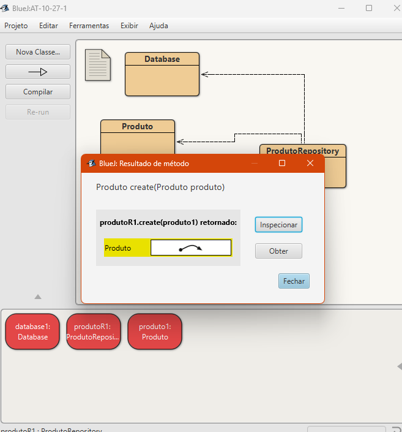

O terminal registrou `Produto cadastrado! ID: 1`, como aparece na [captura do terminal](prints/complementares/04-delete-linha-excluida.png).

## Consulta

Consultei o [ID 1 com loadFromId](prints/complementares/02-read-consulta-por-id.png). Depois chamei `toString()` no objeto retornado para ver os dados.

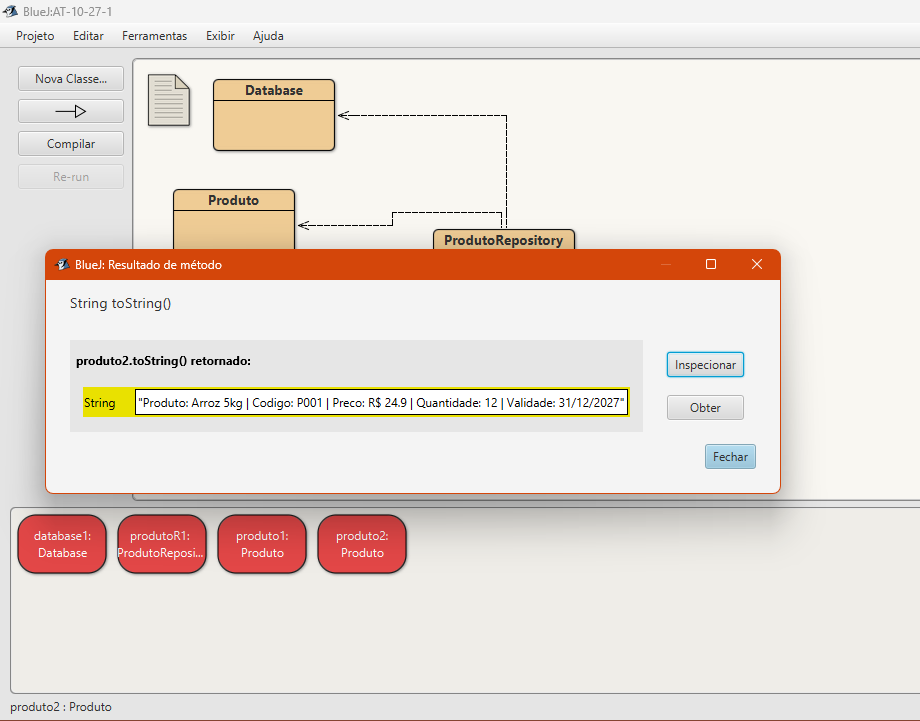

## Atualização

Mudei a quantidade para 20 e chamei `update`. O terminal mostrou `Produtos atualizados: 1`. Fiz outra consulta e a quantidade já estava atualizada.

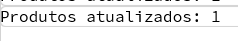

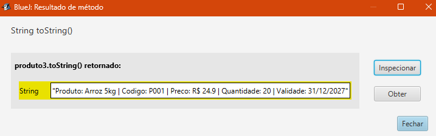

## Exclusão

Chamei [delete passando o produto](prints/complementares/04-delete-execucao.png). O terminal mostrou `Produtos excluidos: 1`.

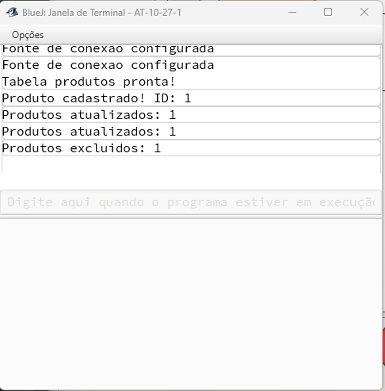

Ao consultar o ID 1 de novo, o resultado foi `null`.

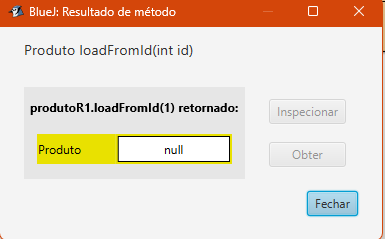

## Persistência

Para esse teste, cadastrei o Feijao 1kg (`P002`), com preço de R$ 8,50, quantidade 15 e validade 15/10/2027. Ele recebeu o ID 2.

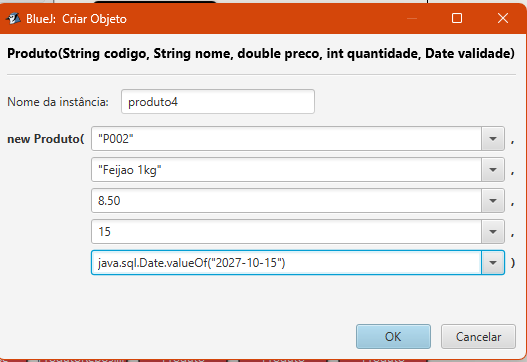

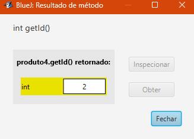

Fechei e abri o BlueJ novamente, criei a conexão com o mesmo banco e consultei o ID 2. Os dados do produto continuaram salvos.

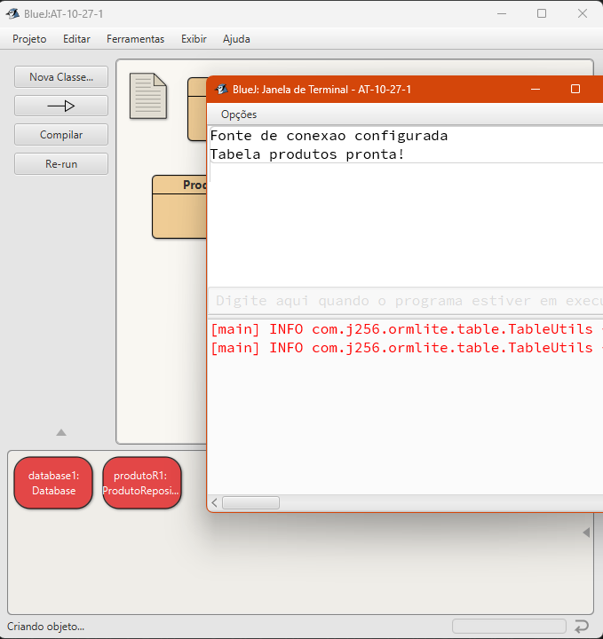

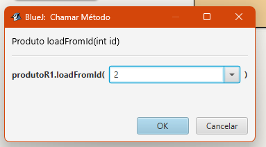

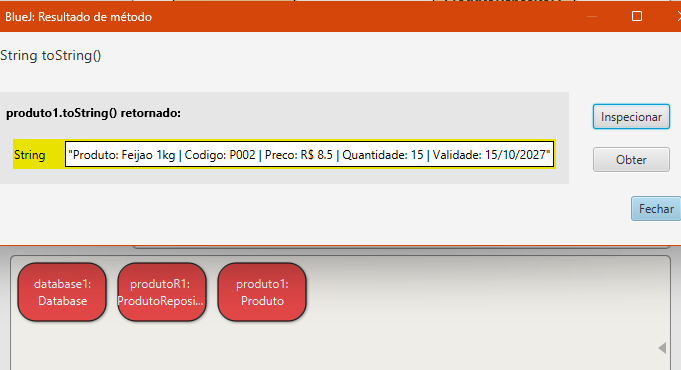

## Para executar

Abra esta pasta no BlueJ e compile as três classes. Crie um `Database("alphafield.db")` e passe esse objeto para o construtor de `ProdutoRepository`.

As bibliotecas estão em `+libs`: ORMLite 6.1, SQLite JDBC 3.46.0.0 e SLF4J 2.0.13. Para a validade, use uma data como `java.sql.Date.valueOf("2027-12-31")`.

Os IDs podem mudar em outros testes. Para testar a persistência, é preciso reabrir a mesma pasta e usar o mesmo banco.

Referência: [tutorial de ORM usado na aula](https://github.com/marceloakira/tutorials/blob/main/orm/README.md).
