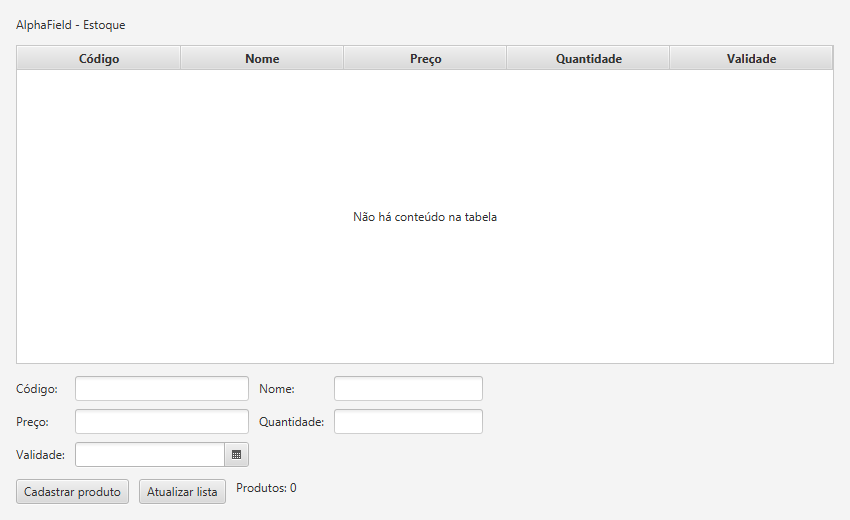
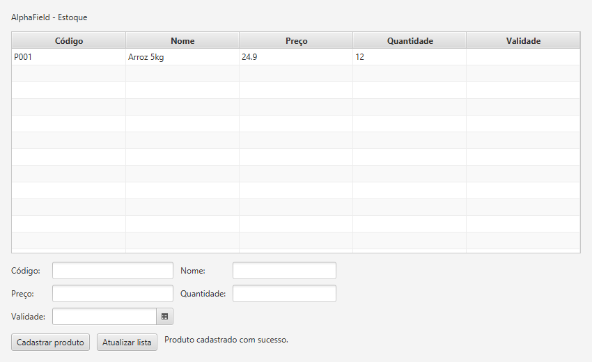
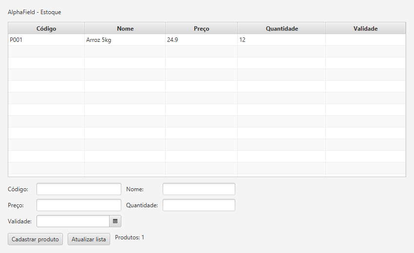

# AT-11-03: AlphaField JavaFX

Tela simples para listar e cadastrar produtos de uma mercearia. A entidade Produto tem código, nome, preço, quantidade e validade. Reaproveitei `Produto`, `Database` e `ProdutoRepository` da [atividade de 27/10](../10-27-cadastro-produtos), sem alterar os arquivos antigos. A tela usa JavaFX e o cadastro fica salvo em SQLite por meio do ORMLite.

## Executar

Com JDK 21 e Maven, nesta pasta execute `mvn javafx:run`. O arquivo `alphafield.db` é criado no diretório de execução. Cadastre um produto, feche e abra novamente para conferir a persistência.

## Capturas

Tela antes do cadastro:

Produto cadastrado pelo botão da tela:

Produto recuperado após reabrir o banco:

