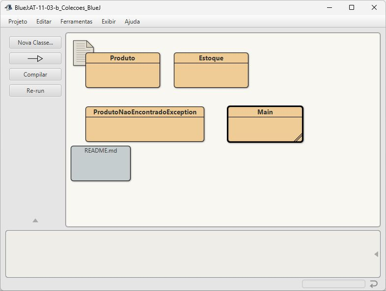
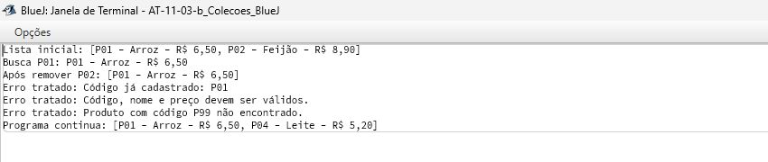

# AT-11-03-b: Coleções e exceções

O exemplo usa produtos do AlphaField, projeto de estoque de mercearia. `Estoque` adiciona, lista, busca e remove produtos. Escolhi `HashMap<String, Produto>` porque o código identifica cada produto e permite acesso direto por chave, além de ajudar a impedir códigos repetidos.

Dados inválidos e códigos duplicados geram `IllegalArgumentException`. Busca ou remoção inexistente gera a exceção personalizada `ProdutoNaoEncontradoException`. O `Main` trata as exceções com `try/catch` e continua após os erros.

## Executar

Com JDK 21, nesta pasta: `javac -encoding UTF-8 *.java` e `java Main`. No BlueJ, abra a pasta como projeto, compile todas as classes e execute `Main.main`.

## Demonstração

Ao executar `Main`, aparecem a inclusão, a listagem, a busca e a remoção. Depois aparecem três erros tratados (código duplicado, preço inválido e produto inexistente). A última linha mostra que o programa continuou e cadastrou outro produto após os erros.

Classes compiladas no BlueJ:

Saída do programa com a lista, a busca, a remoção e os erros tratados:

