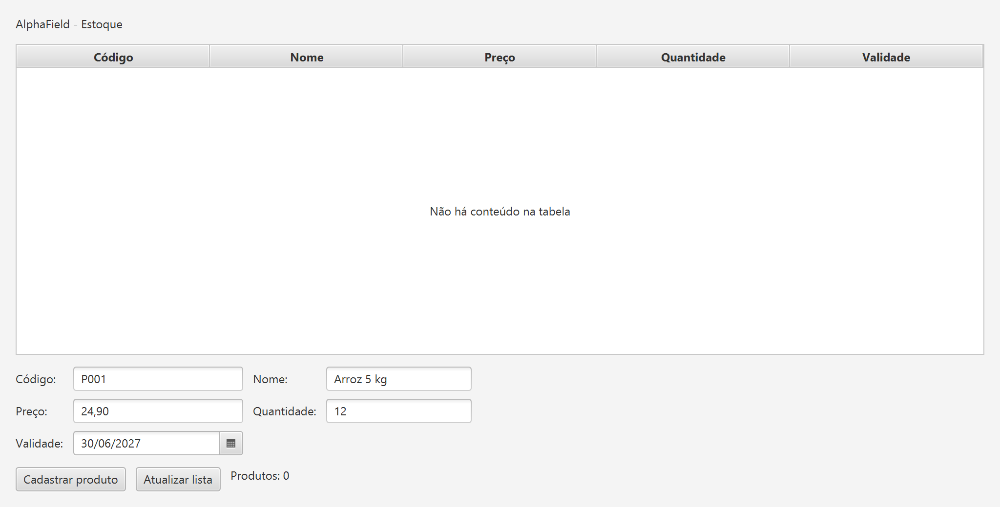
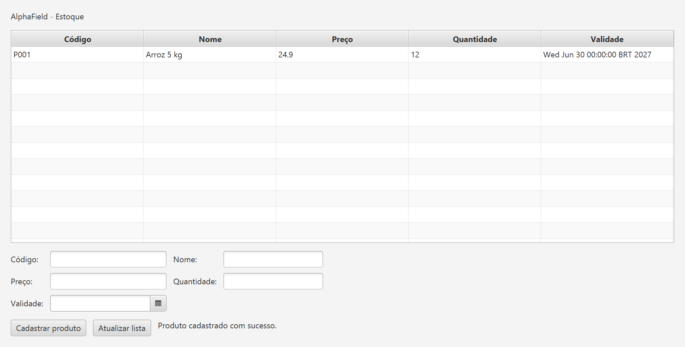
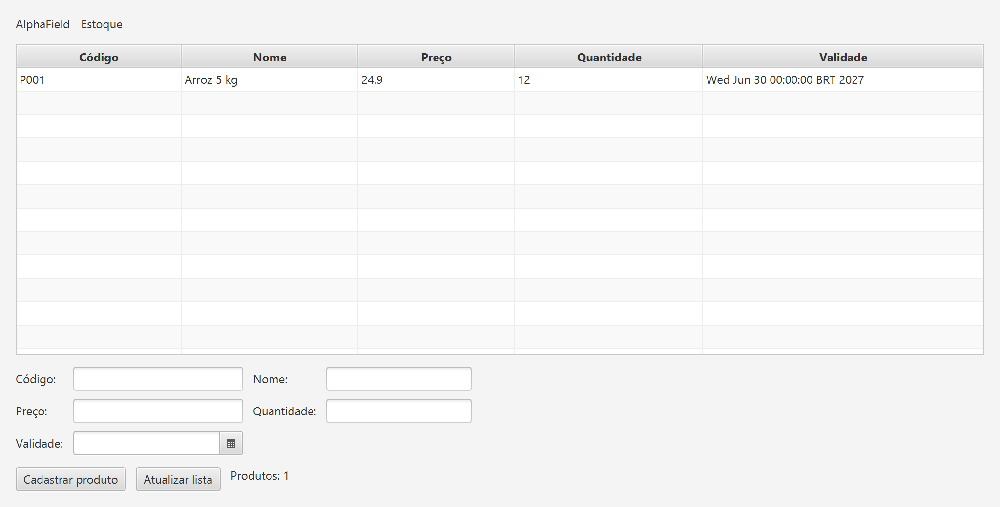

# AT-11-03 · Cadastro de produtos com JavaFX

O AlphaField é um projeto de estoque para pequenas mercearias. Nesta atividade, a tela de produtos lista os registros do banco e permite cadastrar novos itens. A tabela mostra código, nome, preço, quantidade e validade.

## Como executar

Com o JDK 21 e o Maven instalados, abra o terminal nesta pasta e rode:

```sh
mvn javafx:run
```

Na primeira execução, o aplicativo cria o arquivo `alphafield.db` nesta pasta. Para conferir a persistência, feche a janela e execute o mesmo comando novamente no mesmo diretório.

## Organização do código

| Parte | Responsabilidade |
| --- | --- |
| Modelo — `Produto` | Representa o produto e define o mapeamento para a tabela `produtos`. |
| Visão — `ProdutoView` | Monta o formulário e a `TableView` com as cinco colunas. |
| Controlador — `ProdutoController` | Lê e valida o formulário, chama o repositório e recarrega a tabela após o cadastro. |
| Persistência — `ProdutoRepository` e `Database` | Reutiliza a camada da [atividade de ORM](../10-27-cadastro-produtos) para gravar e consultar os produtos no SQLite com ORMLite. |

## Cadastro e consulta

**1. Preencher o formulário.** Com o banco de teste vazio, o formulário recebeu o produto `P001` (Arroz 5 kg), com preço de R$ 24,90, 12 unidades e validade em 30/06/2027.



**2. Cadastrar o produto.** O botão **Cadastrar produto** grava o registro. A tabela é atualizada na hora e o formulário é limpo.



**3. Reabrir o aplicativo.** Na nova execução, o produto aparece na listagem inicial com os dados recuperados do SQLite.


