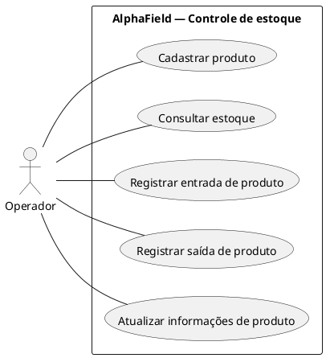

# AT-11-17 · UML com PlantUML

Laboratório de POO (INF0396), Engenharia de Computação da UFG, com o professor Marcelo Akira Inuzuka. Entrega até 23/11/2026.

O AlphaField controla o estoque de pequenas mercearias. O diagrama mostra as operações do Operador, e a descrição explica como funciona a saída de um produto.

## Diagrama



O Operador fica fora do retângulo que representa o AlphaField. As linhas ligam esse ator às operações de que ele participa. A consulta de estoque pode ser feita por conta própria. Na saída, o sistema também verifica o saldo antes de registrar a retirada.

- [Código PlantUML](docs/uml/caso-de-uso.puml)
- [Imagem do diagrama](docs/uml/caso-de-uso.png)
- [Descrição de Registrar saída de produto](docs/uml/descricao-caso-de-uso.md)

## O que conferir na saída

Para QA, o ponto principal é conferir o saldo e o histórico. Se havia 10 unidades e saíram 3, devem sobrar 7 e a saída deve aparecer no histórico. Se a tentativa for recusada, os dois devem ficar como estavam.

A proposta inicial prevê os perfis Gerente e Operador. Ainda falta confirmar com o grupo se o Operador pode fazer as cinco operações do diagrama. A descrição considera um produto por saída, quantidades inteiras e bloqueio de saldo negativo. O fluxo de saída, incluindo o tratamento de falhas, também está aberto à revisão do grupo.

## Como gerar a imagem

Edite o arquivo `.puml`. Com Java e Graphviz instalados, baixe o [JAR do PlantUML](https://plantuml.com/download), salve como `plantuml.jar` na pasta da atividade e rode:

```sh
java -jar plantuml.jar -charset UTF-8 -tpng docs/uml/caso-de-uso.puml
```

Ao alterar o diagrama, envie o `.puml` e o novo PNG juntos.

## Como passar para o repositório do grupo

1. Crie uma branch no repositório oficial. Se tiver apenas acesso de leitura e o grupo permitir, trabalhe em um fork.
2. Baixe os três arquivos de `docs/uml/` e envie juntos para a pasta de documentação do grupo com **Add file → Upload files**.
3. Faça o commit e confira a imagem e a descrição. Se aproveitar este README, ajuste os caminhos dos arquivos na pasta de destino.
4. Quando for enviar para revisão, abra um pull request para a branch indicada pelo grupo e mencione as regras que ainda precisam ser confirmadas.

## Referências

- Proposta Inicial do Projeto Alphafield, seções 1 e 2.2, e enunciado da AT-11-17 na Plataforma Turing.
- [Tutorial do professor · UML Básico com PlantUML](https://github.com/poo-ee-2025-1/tutorials/tree/main/uml-b%C3%A1sico)
- [PlantUML · Diagrama de caso de uso](https://plantuml.com/use-case-diagram)
- [GitHub Docs · Branches](https://docs.github.com/pt/pull-requests/collaborating-with-pull-requests/proposing-changes-to-your-work-with-pull-requests/creating-and-deleting-branches-within-your-repository) · [Forks](https://docs.github.com/pt/pull-requests/collaborating-with-pull-requests/working-with-forks/fork-a-repo) · [Pull requests](https://docs.github.com/pt/pull-requests/collaborating-with-pull-requests/proposing-changes-to-your-work-with-pull-requests/creating-a-pull-request)
- Plano de ensino de INF0396.
